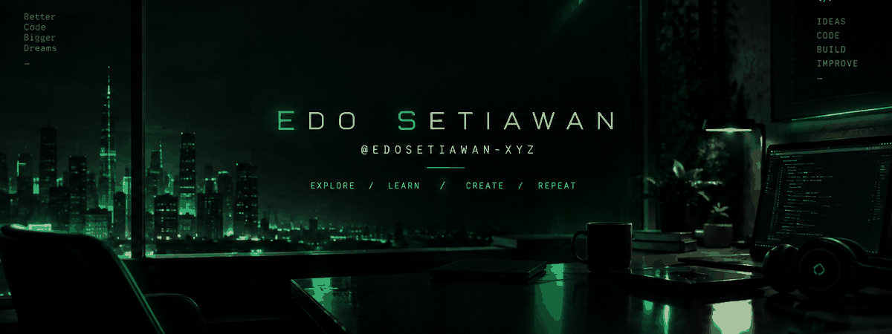
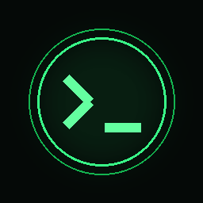

# EDO SETIAWAN

`@edosetiawan-xyz`

**Explore. Learn. Create. Repeat.**

---

## > WHOAMI

Hello, I'm **Edo Setiawan**.

Exploring technology, learning new skills, and building things one step at a time.

- Exploring technology
- Learning and experimenting
- Building personal projects
- Improving every day

## > TECH STACK

## > GITHUB ANALYTICS

 

## > PROJECTS

[Explore my repositories →](https://github.com/edosetiawan-xyz?tab=repositories)

## > CONNECT

  

  

**`END OF TRANSMISSION`**

